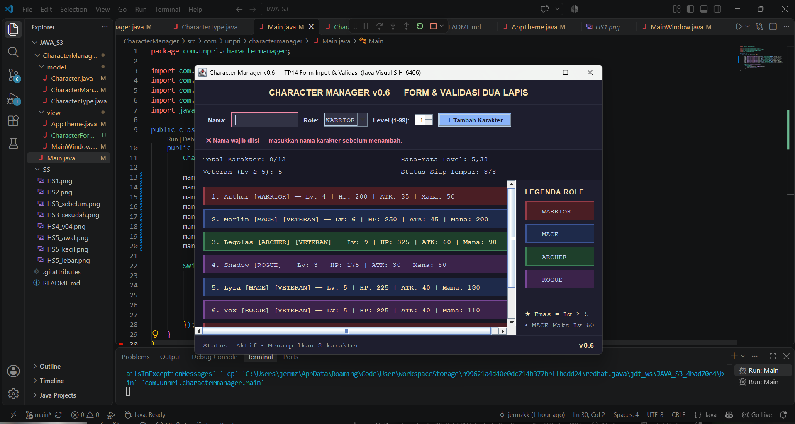
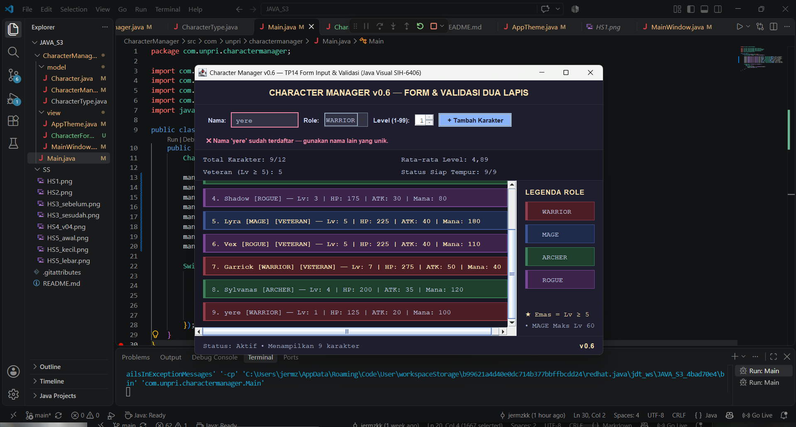
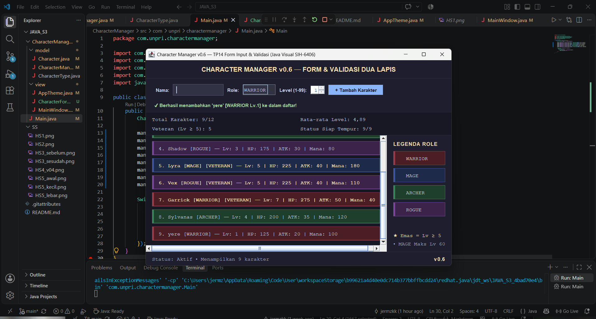

# Character Manager — Java Visual (SIH-6406)

Aplikasi berbasis Java untuk mengelola model data karakter game (`Character`, `CharacterType`), koleksi & validasi bisnis (`CharacterManager`), hingga antarmuka grafis desktop bertema, responsif, dan tervalidasi dua lapis berbasis Java Swing (`CharacterFormPanel`, `MainWindow`, & `AppTheme`).

---

## TP14 — Character Manager Sprint #6 (Form Input, Validasi & Analisis MVC)

### 1. Dokumentasi 3 Skenario Uji Form (`CharacterFormPanel` & `MainWindow` v0.6)
**a. Error Nama Kosong (Border Merah, Fokus Kembali & Pesan Inline):**


**b. Error Nama Duplikat (Deteksi Case-Insensitive `isNameTaken`):**


**c. Sukses Menambahkan Karakter Baru (Kartu Baru Langsung Tampil & Statistik Diperbarui):**


### 2. Dua Aturan Validasi Tambahan Pilihan & Alasan Lapisannya
1. **Larangan Penggunaan Spasi Ganda di Tengah Nama (`cleanName.contains("  ")`) — Diletakkan di Lapisan View (`CharacterFormPanel.validateName()`):**
   * **Alasan:** Merupakan aturan kerapian format teks antarmuka pengguna (*UI input formatting*) sehingga harus ditangkap secepat mungkin di formulir sebelum membentuk objek domain.
2. **Batas Maksimal Kapasitas Tim 12 Karakter (`MAX_ROSTER_CAPACITY = 12`) — Diletakkan di Lapisan Model (`CharacterManager.addCharacter()`):**
   * **Alasan:** Merupakan aturan kuota bisnis inti (*domain invariant*) yang melindungi integritas daftar tim dari mana pun sumber datanya berasal (baik lewat form GUI maupun impor data JSON di masa depan).

### 3. Tabel Pengujian Validasi (8 Kasus Uji)
| No | Input (`Nama` / `Role` / `Level`) | Hasil Diharapkan | Hasil Nyata | Lapisan yang Menangkap |
| :--- | :--- | :--- | :--- | :--- |
| 1 | `""` (kosong) / `WARRIOR` / `1` | Ditolak dengan border merah pada kolom nama & pesan wajib diisi. | Border merah muncul, fokus kembali ke nama, pesan inline tampil. | **View** (`validateName`) |
| 2 | `"Al"` (2 huruf) / `ROGUE` / `5` | Ditolak karena panjang nama kurang dari 3 karakter. | Pesan panjang nama minimal 3 karakter tampil dekat field. | **View** (`validateName`) |
| 3 | `"Arthur123"` / `WARRIOR` / `10` | Ditolak karena mengandung angka/simbol non-alfabet. | Pesan format hanya huruf alfabet & spasi tampil inline. | **View** (`validateName`) |
| 4 | `"Sir  Galahad"` (spasi ganda) / `WARRIOR` / `8` | Ditolak karena terdapat spasi ganda beruntun di tengah nama. | Pesan larangan spasi ganda tampil dan fokus kembali ke field. | **View** (`validateName`) |
| 5 | `"arthur"` (duplikat case-insensitive) / `MAGE` / `4` | Ditolak karena nama sudah terdaftar di `CharacterManager`. | Pesan duplikat tampil dengan border merah pada kolom nama. | **View** (`isNameTaken`) |
| 6 | `"Gandalf"` / `MAGE` / `75` | Ditolak oleh aturan domain karena `MAGE` maksimal level 60. | Pesan penolakan dari `ex.getMessage()` tampil tanpa mengubah form. | **Model** (`Character` Constructor) |
| 7 | `"  Aldric  "` / `WARRIOR` / `12` | Nama di-`trim()` menjadi `"Aldric"`, berhasil disimpan & tampil di kartu ke-9. | Kartu ke-9 `"Aldric [WARRIOR] [VETERAN]"` tampil & pesan hijau sukses muncul. | **View & Model** (Valid) |
| 8 | Karakter ke-13 saat tim sudah berisi 12 karakter | Ditolak karena kapasitas daftar tim sudah penuh (maksimal 12). | Pesan kapasitas penuh dari `IllegalStateException` tampil di form. | **Model** (`CharacterManager`) |

* **Catatan Pengamatan & Tindakan Perbaikan:** Pada pengujian awal sebelum perbaikan `JSpinner`, jika pengguna mengetik angka secara manual pada kotak `JSpinner` lalu langsung menekan tombol tambah tanpa menekan *Enter*, nilai spinner sempat terbaca nilai lama; masalah ini telah diperbaiki dengan memanggil `levelSpinner.commitEdit()` sebelum `levelSpinner.getValue()`.

### 4. Penjelasan Kompromi Sementara Arsitektur MVC (Sprint #6)
Pada Sprint #6 ini, penanganan event klik tombol (`ActionListener`) dan pemanggilan langsung `manager.addCharacter()` masih diletakkan di dalam kelas `CharacterFormPanel` pada lapisan **View** sebagai kompromi sementara agar alur form dapat langsung diuji sebelum pengenalan lapisan **Controller**. Pendekatan ini membuat kelas View masih mengetahui referensi `CharacterManager` dan menjalankan koordinasi penyimpanan secara mandiri. Pada **Pertemuan 9**, kompromi ini akan diperbaiki dengan memindahkan `ActionListener` dan pemanggilan mutasi ke kelas **Controller** terpisah sehingga lapisan View menjadi murni pasif.

### 5. Dokumen Analisis Input & Validasi (Bagian D — TP14)
* **Google Docs Bagian D (TP14):** [JavaVisual_TP14_253303621247_Yeremia_Kembaren](https://docs.google.com/document/d/1YsSWAqQExYDHdjcE7BxQmKvzxESjaeC2-00GklFAzJA/edit?usp=sharing)

---

## Struktur Folder Project
```text
javavisual-tp03-253303621247/
├── README.md
├── SS/
│   ├── HS6_error_kosong.png
│   ├── HS6_error_duplikat.png
│   └── HS6_sukses.png
└── CharacterManager/
    └── src/
        └── com/
            └── unpri/
                └── charactermanager/
                    ├── Main.java
                    ├── model/
                    │   ├── Character.java
                    │   ├── CharacterManager.java
                    │   └── CharacterType.java
                    └── view/
                        ├── AppTheme.java
                        ├── CharacterFormPanel.java
                        └── MainWindow.java