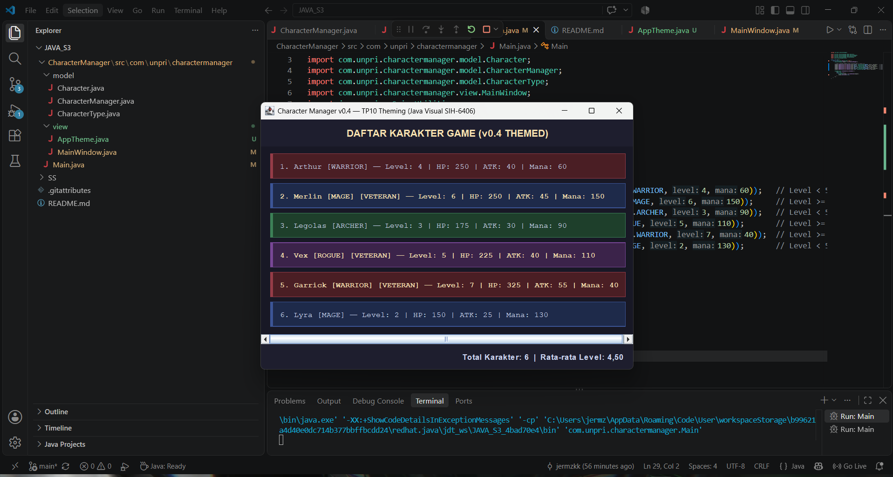

# Character Manager — Java Visual (SIH-6406)

Aplikasi berbasis Java untuk mengelola model data karakter game (`Character`, `CharacterType`), koleksi & validasi bisnis (`CharacterManager`), hingga antarmuka grafis desktop bertema berbasis Java Swing (`MainWindow` & `AppTheme`).

---

## TP10 — Character Manager Sprint #4 (Theming, Properti Komponen & Analisis MVC)

### 1. Perbandingan Tampilan GUI (Sebelum v0.3 vs Sesudah v0.4)
**Sebelum Penerapan Tema (v0.3 — Tampilan Standar):**


**Sesudah Penerapan Tema (v0.4 — Dark Theme, Warna per Role & Veteran Highlight):**


### 2. Alasan Pemisahan Warna di `AppTheme` (View) Bukan di `Character` (Model)
Berdasarkan prinsip *Separation of Concerns* dalam arsitektur **Model–View–Controller (MVC)**, `Character` berada pada lapisan **Model** yang hanya bertugas menyimpan data domain permainan (nama, *role*, level, HP, ATK, mana) tanpa ketergantungan pada pustaka antarmuka grafis (`java.awt.Color`). Pemetaan *role* ke warna ditempatkan di `AppTheme` pada package `view` agar tampilan visual terpusat di satu tempat dan mudah diubah kapan saja tanpa menyentuh logika bisnis. Dengan pemisahan ini, lapisan `model` tetap bersih, mudah diuji secara mandiri, dan dapat digunakan ulang di platform non-Swing.

### 3. Dua Properti Tambahan Pilihan & Alasannya
* **`itemLabel.setToolTipText(...)` (Tooltip Interaktif Detail Karakter):** Menampilkan ringkasan lengkap status karakter (nama, *role*, level, HP, ATK, mana, dan status tempur) saat pengguna mengarahkan kursor ke kartu karakter, sehingga informasi tambahan tersedia tanpa membuat teks kartu utama terlihat penuh.
* **`itemLabel.setBorder(AppTheme.borderFor(c.getType()))` (Border Aksen Samping per Role):** Menambahkan garis aksen warna cerah selebar 5 piksel di sisi kiri setiap kartu sesuai *role* karakter untuk memperjelas pemisahan antarbaris kartu dan meningkatkan kontras visual pada tema gelap.

### 4. Dokumen Analisis Properti & MVC (Bagian D — TP10)
* **Google Docs Bagian D (TP10):** [JavaVisual_TP10_253303621247_Yeremia_Kembaren](https://docs.google.com/document/d/1_K0CZXq6s3aV8OXRM-NL97nJEqjQyhTWubjqwPLSNjs/edit?usp=sharing)

---


## Struktur Folder Project
```text
JAVA_S3/
├── README.md
├── SS/
│   ├── HS1.png
│   ├── HS2.png
│   ├── HS3_sebelum.png
│   ├── HS3_sesudah.png
│   └── HS4_v04.png
└── CharacterManager/
    └── src/
        └── com/
            └── unpri/
                └── charactermanager/
                    ├── Main.java
                    ├── model/
                    │   ├── Character.java
                    │   ├── CharacterManager.java
                    │   └── CharacterType.java
                    └── view/
                        ├── AppTheme.java
                        └── MainWindow.java