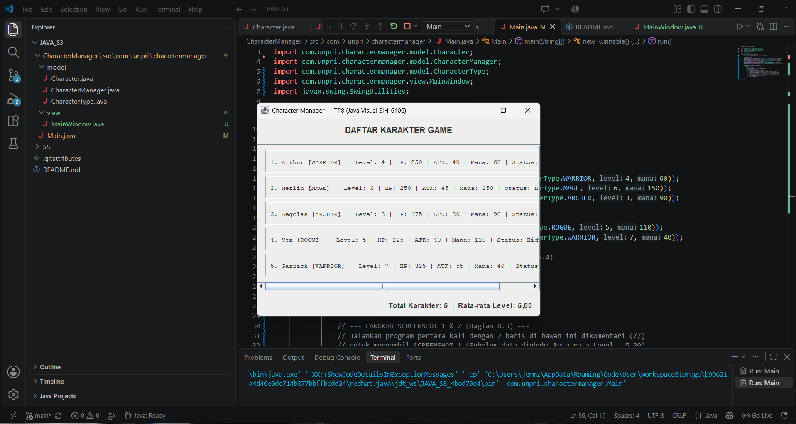
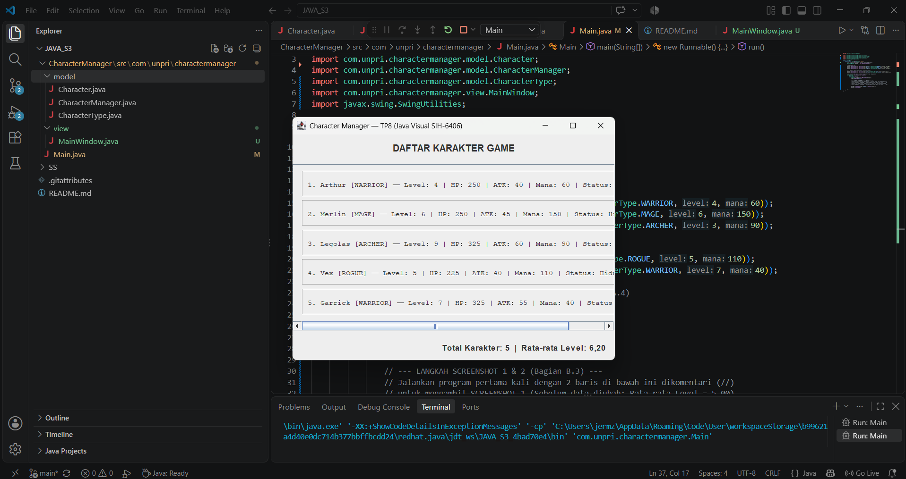

# Character Manager — Java Visual (SIH-6406)

Aplikasi berbasis Java untuk mengelola model data karakter game (`Character`, `CharacterType`), koleksi & validasi bisnis (`CharacterManager`), hingga antarmuka grafis desktop berbasis Java Swing (`MainWindow`).

---

## TP8 — Character Manager Sprint #3 (MainWindow, Data Dinamis & Analisis MVC)

### 1. Tampilan GUI MainWindow (Sebelum & Sesudah Perubahan Data)
**Sebelum Perubahan Data (5 Karakter Awal — Rata-rata Level: 5.00):**


**Sesudah Perubahan Data (Level Legolas Naik ke 9 — Rata-rata Level: 6.20):**


### 2. Aliran Data dalam Arsitektur MVC (`Main → CharacterManager → MainWindow`)
Dalam pola arsitektur **Model–View–Controller (MVC)**, `Main.java` bertindak sebagai titik inisialisasi aplikasi yang menyiapkan data awal dan meneruskannya ke lapisan **Model** (`CharacterManager`) untuk divalidasi serta disimpan secara terenkapsulasi. Selanjutnya, `Main` menginstansiasi **View** (`MainWindow`) di dalam *Event Dispatch Thread* (EDT) dengan menyuntikkan referensi `CharacterManager` ke dalamnya. Saat dirender, `MainWindow` membaca daftar karakter serta perhitungan rata-rata level dari `CharacterManager` secara dinamis tanpa menyimpan logika bisnis sendiri, sehingga perubahan data pada Model langsung tercermin akurat di tampilan GUI.

### 3. Daftar Karakter Baru & Alasan Pemilihan Tipe/Level
* **Vex (`ROGUE` — Level 5, Mana 110):** Ditambahkan untuk melengkapi variasi *role* serangan cepat dengan cadangan mana menengah sehingga komposisi tim tidak didominasi kelas petarung jarak dekat saja.
* **Garrick (`WARRIOR` — Level 7, Mana 40):** Dipilih bertipe *Warrior* berlevel tinggi untuk menguji perhitungan rata-rata level tim sekaligus memvalidasi bahwa karakter dengan mana rendah tetap dirender akurat pada daftar dinamis.

### 4. Dokumen Analisis GUI & MVC (Bagian D — TP8)
* **Google Docs Bagian D (TP8):** [JavaVisual_TP08_253303621247_Yeremia_Kembaren](https://docs.google.com/document/d/1HGafESz512VZfePXzdJm1gV5gM94N6neyaOBkhK7jkc/edit?usp=sharing)

---

## TP5 — Character Manager Sprint #2 (Collections & Encapsulation)

### Output Terminal (Sprint #2)


### Fitur Analitik Mandiri (Bagian C — Sprint #2)
* **Method Baru:** `getCombatReadyCasters(int minMana)` pada `CharacterManager.java`
* **Rasional Desain:** Memfilter karakter yang masih hidup (`isAlive() == true`) sekaligus memiliki cadangan energi (`mana >= minMana`) untuk melancarkan serangan sihir tim, dengan mengembalikan `ArrayList` baru demi menjaga prinsip *defensive copying*.

---

## Struktur Folder Project
```text
javavisual-tp03-253303621247/
├── README.md
├── SS/
│   ├── HS1.png
│   ├── HS2.png
│   ├── HS3_sebelum.png
│   └── HS3_sesudah.png
└── CharacterManager/
    └── src/
        └── com/
            └── unpri/
                └── charactermanager/
                    ├── Main.java
                    ├── model/
                    │   ├── Character.java
                    │   ├── CharacterManager.java
                    │   └── CharacterType.java
                    └── view/
                        └── MainWindow.java