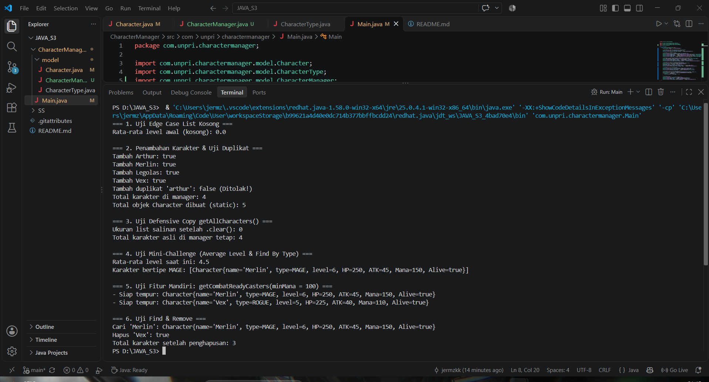

# Character Manager — Java Visual (SIH-6406)

Aplikasi berbasis konsol Java untuk mengelola model data karakter game, koleksi karakter menggunakan `ArrayList`, validasi duplikasi nama, analitik tim, serta penerapan prinsip *encapsulation* dan *defensive copying*.

## Output Terminal (Sprint #2 — TP5)


## Fitur Analitik Mandiri (Bagian C — Sprint #2)
* **Method Baru:** `getCombatReadyCasters(int minMana)` pada `CharacterManager.java`
* **Rasional Desain:** Dalam skenario permainan RPG, sistem sering perlu memfilter karakter mana saja yang masih hidup (`isAlive() == true`) sekaligus memiliki cadangan energi (`mana >= minMana`) untuk melancarkan serangan sihir tim. Method ini menggabungkan dua kriteria status objek tanpa mengekspos internal `ArrayList<Character>` asli, karena hasilnya dikembalikan dalam bentuk instansiasi `ArrayList` baru sehingga pihak pemanggil tidak dapat memodifikasi daftar utama karakter secara tidak sah.

## Struktur Folder Project
```text
javavisual-tp03-253303621247/
├── README.md
├── SS/
│   ├── HS1.png
│   └── HS2.png
└── CharacterManager/
    └── src/
        └── com/
            └── unpri/
                └── charactermanager/
                    ├── Main.java
                    └── model/
                        ├── Character.java
                        ├── CharacterManager.java
                        └── CharacterType.java

Link Docs (https://docs.google.com/document/d/1Yj6eGSeuY0XbBxdHvvRuKzmKI0v9EQ_aQUSR8gI67Kk/edit?usp=sharing)                        