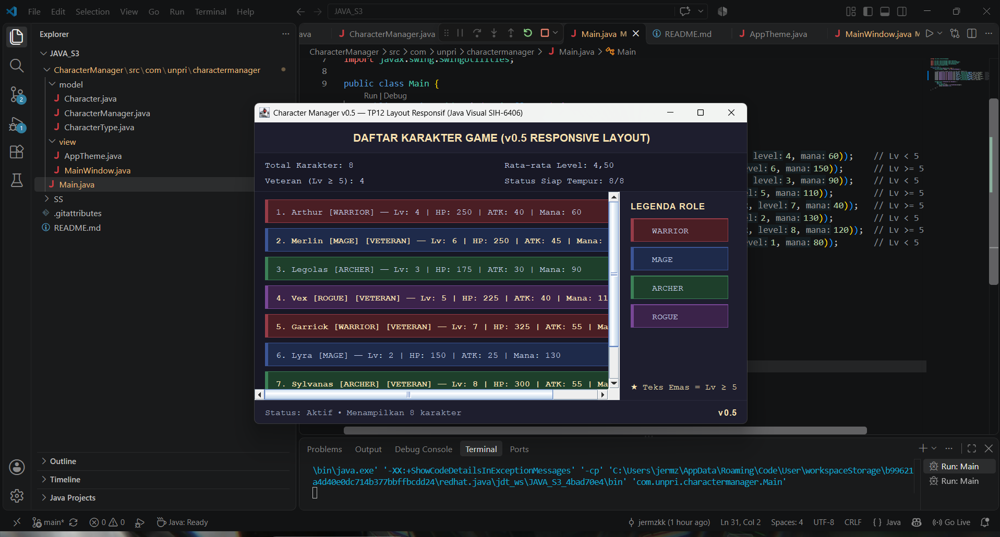
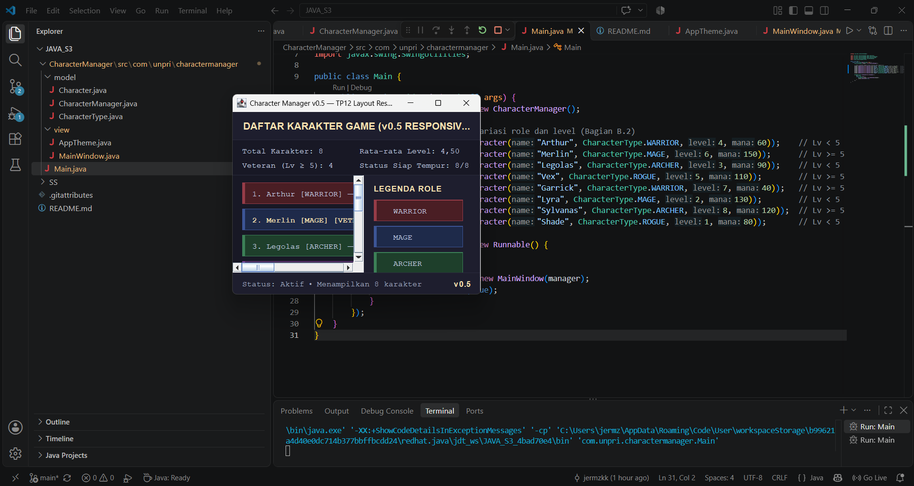
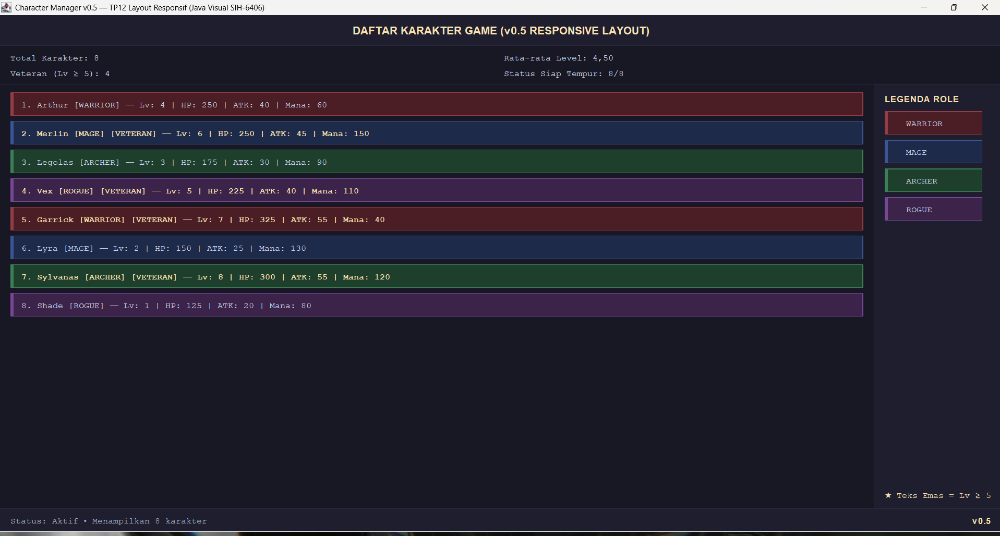

# Character Manager — Java Visual (SIH-6406)

Aplikasi berbasis Java untuk mengelola model data karakter game (`Character`, `CharacterType`), koleksi & validasi bisnis (`CharacterManager`), hingga antarmuka grafis desktop bertema dan responsif berbasis Java Swing (`MainWindow` & `AppTheme`).

---

## TP12 — Character Manager Sprint #5 (Layout, UI Responsif & Analisis MVC)

### 1. Wireframe Tata Letak `MainWindow` v0.5
```text
+-----------------------------------------------------------------------+
| [NORTH] Header Judul: DAFTAR KARAKTER GAME (v0.5 RESPONSIVE LAYOUT)   |
| +---------------------------------+---------------------------------+ |
| | Total Karakter: 8               | Rata-rata Level: 4.50           | |
| | Veteran (Lv >= 5): 4            | Status Siap Tempur: 8/8         | |
| +---------------------------------+---------------------------------+ |
+---------------------------------------------------+-------------------+
| [CENTER] JScrollPane -> listWrapper (NORTH)       | [EAST] BoxLayout  |
|  +---------------------------------------------+  |  LEGENDA ROLE     |
|  | 1. Arthur [WARRIOR] — Lv: 4 | HP: 200 ...   |  |  [ WARRIOR ]      |
|  +---------------------------------------------+  |  [ MAGE    ]      |
|  | 2. Merlin [MAGE] [VETERAN] — Lv: 6 ...      |  |  [ ARCHER  ]      |
|  +---------------------------------------------+  |  [ ROGUE   ]      |
|  | ... (8 kartu karakter dinamis) ...          |  |  (Vertical Glue)  |
|  +---------------------------------------------+  |  ★ Teks Emas >= 5 |
+---------------------------------------------------+-------------------+
| [SOUTH] Status: Aktif • Menampilkan 8 karakter                 v0.5   |
+-----------------------------------------------------------------------+

## TP12 - Sprint #5

### Screenshot Perubahan Tampilan (v0.5)
- **Ukuran Awal (v0.5):**
  
- **Ukuran Kecil / Scrollbar (v0.5):**
  
- **Ukuran Besar / Maximized (v0.5):**
  

Link Docs (https://docs.google.com/document/d/15HvEVzajQb468gRHYHkApt0WD-XNsZ7FdPljQm9czhg/edit?usp=sharing)