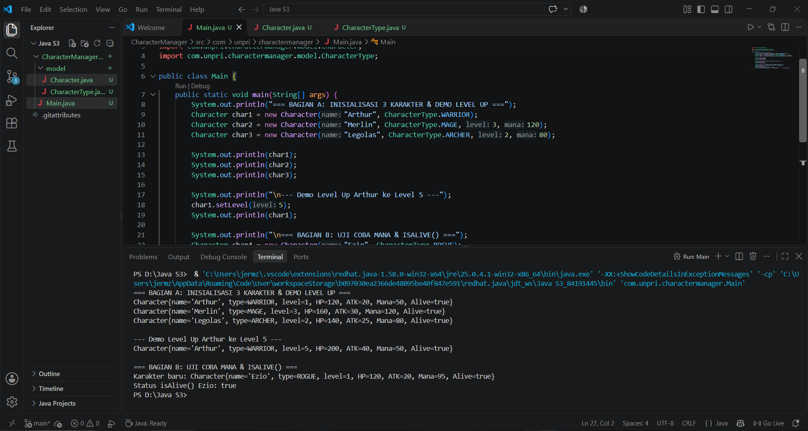

# Character Manager — TP3 (Java Visual SIH-6406)

Aplikasi berbasis konsol Java untuk mengelola model data karakter game beserta atribut statistik, sistem level-up, manajemen kapasitas mana, dan pengecekan status kehidupan karakter (`isAlive`). Proyek ini dibangun sebagai fondasi arsitektur *object-oriented* sebelum pengembangan antarmuka grafis (GUI) pada sprint berikutnya.

## Output Terminal


## Struktur Folder Project
```text
javavisual-tp03-253303621247/
├── README.md
├── SS/
│   └── HS1.png
└── CharacterManager/
    └── src/
        └── com/
            └── unpri/
                └── charactermanager/
                    ├── Main.java
                    └── model/
                        ├── Character.java
                        └── CharacterType.java

Link Docs (https://docs.google.com/document/d/18qTZDKmUZBVnIrLwImsXY1Hm4oBZjpV5lMth0tJmYN0/edit?usp=sharing)